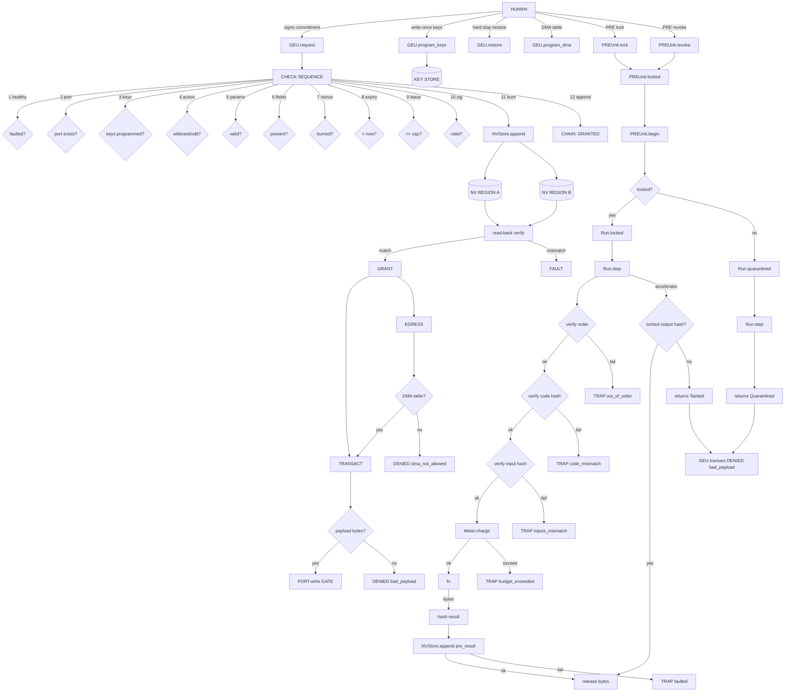

# vega-chip-sdk — Architecture

## 1. The organism (family picture)

The 16-layer stack from ORGANISM_MAP.md with **this repo's layer marked**:

```
                 ┌──────────────────────────┐
                 │   THE HUMAN (the owner)  │  holds the only signing key;
                 │  authority starts here   │  spends it one action at a time
                 └────────────┬─────────────┘
                              v single-use signed commitments
 15 assemble   vega-umbrella-sdk        the family as one organism: one keyed
                                         ledger, one approval check, one anchor,
                                         registry + pre-deploy audit
 14 deliberate vega-council-sdk         multi-brain deliberation, design-first builder
               vega-galaxy-sdk          the galaxy view of the knowledge lattice:
                                         levels, convergence, futures above the present
 13 watch      vega-governance-feed-sdk  live view of every chain + tamper alarms
 12 verify     vega-metacog-sdk          evidence rungs and the completion gate
 11 reason     vega-reasoning-sdk        fidelity, forecasting, routing: the lattice
                                         that predicts steps ahead
 10 observe    vega-trace-sdk            telemetry of reasoning: layer traces, entropy,
                                         harmonic echo, reference signature
  9 interface  vega-terminal-sdk         gated command execution for people and agents
  8 learn      vega-train-sdk            governed training + freeze cards: records
                                         exactly what a model learned from
  7 knowledge  vega-dkg-lattice-sdk      the knowledge graph: every fact with origin
                                         and licence; repo-library processing
  6 conduct    vega-harness-sdk          deterministic workflow conduct, pre-registered
                                         predicted paths, library use gate
  5 memory     vega-librarian-sdk        lessons and memory of past incidents
  4 contain    vega-two-gate-sdk         containment between two gates + the hard stop
  3 adapt      vega-pareah-sdk            adapters, cards, quarantine of inbound code:
                                         the dead-end room for the unannounced
  2 seal       vega-superproof-sdk       layered sealing and proof tiers
  1 authority  vega-governance-jacket-sdk human-only actions, single-use signed
                                         commitments, entry and exit gates
  0 record     vega-custody-sdk          capsules, DAG, hash-chained ledger, safe paths,
                                         bounded processes — the foundation everything
                                         writes to
                    ▲
                    │
              >>> vega-chip-sdk <<<      layer 14 (deliberate): software reference model
                                         of the governance hardware (GEU, PRE, NV)
                                         depends on: custody (0), jacket (1)
                                         provides: nv, geu, pre_unit, conformance
```

**What layers below provide:** `vega-custody-sdk` (layer 0) supplies the hash-chained ledger, DAG, and safe paths that the NV model and GEU chain append to. `vega-governance-jacket-sdk` (layer 1) supplies the commitment format, signature verification, action hashing, and the software jacket's exit gate that conformance tests against.

**Who above consumes:** `vega-council-sdk` and `vega-galaxy-sdk` (layer 14 peers) may use the hardware model's decision chain for deliberation and galaxy views. `vega-umbrella-sdk` (layer 15) assembles the family and runs the pre-deploy audit.

> One family, one organism: every SDK owns exactly one concern and uses the owner of every other concern instead of growing its own copy.

## 2. Internal drawing — modules and flow

### Data flow (records, hashes, payloads)

```
┌─────────────┐     ┌─────────────┐     ┌─────────────┐
│   HUMAN     │     │   CALLER    │     │  ACCELERATOR│
│  (signs)    │     │  (requests) │     │  (compute)  │
└──────┬──────┘     └──────┬──────┘     └──────┬──────┘
       │                   │                   │
       │ commitment        │ request(action,   │ step fn
       │ {nonce,expiry,    │  params,signed,  │ (code,inputs)
       │  signature}       │  port)            │
       ▼                   ▼                   ▼
┌─────────────────────────────────────────────────────────┐
│                      GEU                                 │
│  ┌─────────┐  ┌─────────┐  ┌─────────┐  ┌─────────────┐ │
│  │  KEYS   │  │  NV     │  │  CLOCK  │  │  PORTS      │ │
│  │ STORE   │──│ STORE   │  │         │  │  (net,disk, │ │
│  │(write-1)│  │(dual,   │  │monotonic│  │  display)   │ │
│  └─────────┘  │ chained)│  │         │  │  closed by  │ │
│              └────┬────┘  └────┬────┘  │  default    │ │
│                   │            │       └──────┬──────┘ │
│                   ▼            ▼              ▼        │
│  ┌─────────────────────────────────────────────────┐   │
│  │              CHECK SEQUENCE                      │   │
│  │ 1. healthy?  2. port?  3. keys?  4. action?     │   │
│  │ 5. params?  6. fields? 7. nonce? 8. expiry?     │   │
│  │ 9. lease?  10. sig?  11. BURN  12. append GRANT │   │
│  └────────────────────┬────────────────────────────┘   │
│                       │                                │
│                       ▼                                │
│              ┌─────────────────┐                       │
│              │   GRANT         │                       │
│              │ (port, ah, exp) │                       │
│              └────────┬────────┘                       │
│                       │                                │
│          ┌────────────┼────────────┐                   │
│          ▼            ▼            ▼                   │
│     ┌─────────┐ ┌───────────┐ ┌────────────┐          │
│     │TRANSACT │ │  EGRESS   │ │RAW_PORT    │          │
│     │(grant,  │ │(initiator,│ │_WRITE      │          │
│     │ payload)│ │ port, g)  │ │(bypass)    │          │
│     └────┬────┘ └─────┬─────┘ └─────┬──────┘          │
│          │            │            │                   │
│          ▼            ▼            ▼                   │
│     ┌─────────────────────────────────┐               │
│     │        CHAIN APPEND             │               │
│     │  decision: GRANTED/DENIED       │               │
│     │  pre_lock, pre_revoke,          │               │
│     │  pre_result, pre_refused,       │               │
│     │  hard_stop, restore, dma        │               │
│     └─────────────────────────────────┘               │
└─────────────────────────────────────────────────────────┘
                       │
                       ▼
              ┌─────────────────┐
              │   PRE UNIT      │
              │  ┌───────────┐  │
              │  │  LOCKED   │  │
              │  │ WORKFLOWS │  │
              │  └─────┬─────┘  │
              │        │        │
              │  ┌─────┴─────┐  │
              │  │   RUN     │  │
              │  │ step():   │  │
              │  │ verify    │  │
              │  │ code,     │  │
              │  │ inputs,   │  │
              │  │ budget,   │  │
              │  │ hash→chain│  │
              │  │ release   │  │
              │  └───────────┘  │
              └─────────────────┘
```

### Authority flow (human-signed commitments only)

```
HUMAN KEY (never on model side)
       │
       ├──────────────────────────────────────────────┐
       │                                              │
       ▼                                              ▼
┌──────────────────┐                        ┌──────────────────┐
│  GEU: program_keys│                        │  GEU: request    │
│  (write-once,     │                        │  (commitment     │
│   1-4 Ed25519)   │                        │   checked,       │
└──────────────────┘                        │   nonce burned)  │
                                            └────────┬─────────┘
                                                     │
                    ┌────────────────────────────────┘
                    ▼
            ┌───────────────┐
            │  GRANT issued │  (authority to act ONCE)
            └───────┬───────┘
                    │
         ┌──────────┼──────────┐
         ▼          ▼          ▼
    ┌────────┐ ┌────────┐ ┌────────┐
    │TRANSACT│ │ EGRESS │ │ RESTORE│  (each needs the GRANT
    │(once)  │ │(DMA)   │ │(human) │   or its own commitment)
    └────────┘ └────────┘ └────────┘
         │          │          │
         └──────────┼──────────┘
                    ▼
            ┌───────────────┐
            │  CHAIN RECORD │  (append-only, hash-chained)
            │  every step   │
            └───────────────┘
```

## 3. Mermaid diagram — internal modules



## 4. Sequence — main scenario end to end

### Scenario: Human approves an action; GEU grants; caller transacts; PRE runs a locked workflow step

```mermaid
sequenceDiagram
    participant H as HUMAN
    participant G as GEU
    participant N as NVStore
    participant P as PREUnit
    participant C as CALLER
    participant A as ACCELERATOR

    Note over H: Human decides on action
    H->>H: Generates nonce, signs commitment<br/>{action, params, nonce, expiry, signature}
    H->>C: Hands commitment to caller
    C->>G: request(action, params, signed, "net")
    G->>G: Check sequence (1-10)
    alt Any check fails
        G->>N: Append DENIED decision
        G-->>C: Denied(reason)
    else All checks pass
        G->>N: Append BURN (nonce hash) + read-back
        alt Burn fails
            G->>G: _fault()
            G-->>C: Denied(faulted)
        else Burn ok
            G->>N: Append GRANTED decision + read-back
            alt Append fails
                G->>G: _fault()
                G-->>C: Denied(faulted)
            else Append ok
                G-->>C: Grant(port, action_hash, expiry)
                C->>G: transact(grant, payload_bytes)
                G->>G: Verify grant matches, not used, not expired
                alt Verify fails
                    G-->>C: Denied(gate_closed|expired|bad_payload)
                else Verify ok
                    G->>N: Append decision (implicit in transact path)
                    G->>C: bytes written
                    Note over G: Grant consumed, port closed
    end

    Note over H: Human locks a workflow
    H->>H: Signs lock_pre commitment for workflow + steps
    H->>P: lock("daily-report", steps, signed)
    P->>G: _check("lock_pre", {...}, signed)
    G->>N: Append BURN + GRANTED
    P->>N: Append pre_lock record
    P-->>C: locked["daily-report"] = steps

    Note over C: Caller runs the workflow
    C->>P: begin("daily-report")
    P-->>C: Run(steps=locked)
    C->>P: run.step("fetch", code, inputs, fn)
    P->>P: Verify order, code hash, input hash
    P->>P: Meter.charge(budget)
    P->>A: fn(meter)  [runs on accelerator]
    A-->>P: result_bytes
    P->>P: Hash result
    P->>N: Append pre_result (hash on chain BEFORE release)
    alt Locked output hash matches
        P-->>C: result_bytes
    else No locked output hash
        P-->>C: Tainted(result)
        Note over C: GEU.transact will refuse Tainted
    end
```

## 5. Trust boundaries

| Boundary | What crosses | Enforcement |
|---|---|---|
| **Human ↔ GEU** | Signed commitments (nonce, expiry, signature) | Ed25519 verification under programmed keys; nonce burned in NV; single-use |
| **Caller ↔ GEU** | `request` (action, params, signed, port), `transact` (grant, payload) | Gate token (`_GATE` object) required for port write; grant identity checked; one transaction |
| **GEU ↔ NVStore** | Append records (both regions), read-back verification | Dual-region write + fsync + read-back compare; mismatch = `NVFault` = unit faults |
| **GEU ↔ PREUnit** | `lock_pre`, `pre_revoke`, `pre_result`, `pre_refused` records | PRE calls `GEU._check` and `GEU._append`; PRE refusals recorded in chain |
| **PREUnit ↔ Caller** | `Run.step` (code, inputs, fn), returns bytes/Quarantined/Tainted | Code/input hashes verified against locked list; budget metered; result hash on chain before release |
| **Accelerator ↔ PREUnit** | `fn` execution, returns result | Result tainted unless locked output hash matches; gate refuses tainted |
| **DMA Initiator ↔ GEU** | `egress` (initiator, port, payload, grant) | DMA table (human-signed config) checked; then `transact` |
| **Bypass attempt ↔ GEU** | `raw_port_write` (port, payload) | Always denied, recorded as `side_door`; hard stop if `trip_on_side_door` |
| **Restart ↔ GEU/PRE/NV** | Chain records replayed to rebuild state | Keys, burned nonces, hard_stop, dma table, locked workflows all reconstructed from chain |

---

**Diagram rules followed:** ASCII uses only `| - + > < v ^ ( ) [ ] = : .` and spaces. Mermaid uses simple node IDs (A, B, C...), no parentheses or quotes inside labels.