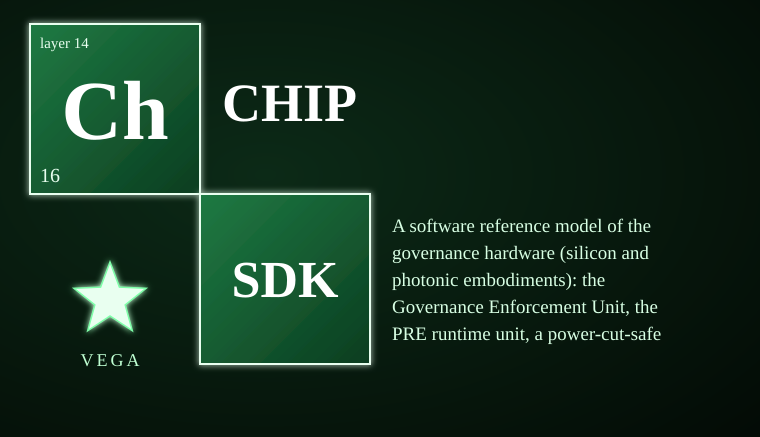

# vega-chip-sdk



A software reference model of the governance hardware (silicon and photonic embodiments): the Governance Enforcement Unit (GEU), the PRE runtime unit, a power-cut-safe non-volatile memory model, and conformance tests that prove the hardware model decides identically to the software jacket on every signed attempt.

> **Licensing.** Source-available, not open source. Free for personal use; free for registered small businesses (under US$1M revenue and valuation); everyone else needs a commercial license (see LICENSE; for a commercial license write to jasonblasiak.ai.mail@gmail.com). Patent pending. Draft licence text, not yet reviewed by an attorney.

## Table of Contents

- [Specifications](#specifications)
- [End-to-end functions](#end-to-end-functions)
- [Controls](#controls)
- [What it CANNOT do](#what-it-cannot-do)
- [Platform support](#platform-support)
- [Standalone & unified install](#standalone--unified-install)
- [Diagnostic control surface](#diagnostic-control-surface)
- [Fail-closed constraints & custom constraints](#fail-closed-constraints--custom-constraints)
- [Tests](#tests)
- [Status & honesty](#status--honesty)

## Specifications

| Item | Value |
|---|---|
| Version | 0.1.0 |
| Python | >=3.10 |
| Dependencies | cryptography>=42, vega-custody-sdk, vega-governance-jacket-sdk |
| Tests | 30 tests in 1 file, all passing |
| Status | BUILT: nv, geu, pre_unit, conformance. DESIGNED ONLY: FPGA/silicon prototype, photonic accelerators (untrusted compute inside the gate). See STATUS.md. |

## End-to-end functions

1. **Program keys** — Human provides 1–4 Ed25519 public keys once; stored write-once in the GEU.
2. **Request an action** — Caller supplies action name, parameters, and a human-signed commitment (nonce, expiry, signature). GEU checks: unit healthy, port exists, action not wildcard/odd-spelled, nonce not burned, expiry in future and within lease cap, signature valid under a programmed key. On first failure: deny, record, stop.
3. **Burn the nonce** — Before any gate opens, the nonce hash is appended to both non-volatile regions and read back. If the append fails, the unit faults and nothing opens.
4. **Grant issued** — A `Grant` object is returned, bound to one port, one action hash, one expiry.
5. **Transact once** — Caller passes the exact `Grant` and a bytes payload. GEU verifies grant matches the open grant for that port, not used, not expired. On success: payload passes through the port, grant closes, decision recorded.
6. **Hard stop** — Anyone can engage; all grants cleared; unit refuses all requests. Lifting requires a human commitment for `restore_after_hard_stop`.
7. **PRE lock** — Human commits to a workflow name and an ordered step list (code hash, input hash, optional output hash, budgets). Locking the same name again is refused.
8. **PRE run (locked)** — Steps execute in order; before each, code hash and input hash are verified against the locked list. Budget metered. Result hash appended to chain BEFORE result released.
9. **PRE run (unlocked)** — Runs in quarantine; results wrapped in `Quarantined`; output gate refuses them.
10. **Accelerator step** — Result is `Tainted` unless a locked output hash vouches for it; gate refuses tainted results.
11. **Conformance** — Same signed attempts run through software jacket and GEU; any decision mismatch is a finding.

## Controls

| Entry point | Module | Parameters | Effect |
|---|---|---|---|
| `GEU.program_keys(pubs)` | geu | `pubs`: list[bytes] (1–4, 32 bytes each) | Write-once key store; repeats denied |
| `GEU.request(action, params, signed, port)` | geu | `action`: str, `params`: dict, `signed`: {nonce, expiry, signature}, `port`: str | Runs full check sequence; returns `Grant` or raises `Denied(reason)` |
| `GEU.transact(grant, payload)` | geu | `grant`: Grant, `payload`: bytes | One transaction on the granted port; grant consumed |
| `GEU.hard_stop()` | geu | — | Engages hard stop; clears all grants |
| `GEU.restore(signed)` | geu | `signed`: commitment for `restore_after_hard_stop` | Human-only lift; re-engages stop on replay |
| `GEU.program_dma(table, signed)` | geu | `table`: dict[initiator, list[port]], `signed`: commitment for `change_gate_config` | Sets DMA side-door table; human-only |
| `GEU.egress(initiator, port, payload, grant)` | geu | `initiator`: str, `port`: str, `payload`: bytes, `grant`: Grant | DMA path; checks table, then transacts |
| `GEU.raw_port_write(port, payload)` | geu | `port`: str, `payload`: bytes | Bypass attempt; always denied, recorded, trips hard stop if configured |
| `PREUnit.lock(workflow, steps, signed)` | pre_unit | `workflow`: str, `steps`: list[dict], `signed`: commitment for `lock_pre` | Registers locked workflow; no silent replacement |
| `PREUnit.revoke(workflow, signed)` | pre_unit | `workflow`: str, `signed`: commitment for `revoke_authority` | Removes locked workflow; human-only |
| `PREUnit.begin(workflow)` | pre_unit | `workflow`: str | Returns `Run` (locked or quarantined) |
| `Run.step(step_id, code, inputs, fn, accelerator=False)` | pre_unit | `step_id`: str, `code`: bytes, `inputs`: bytes, `fn`: callable(Meter)->bytes, `accelerator`: bool | Executes one step; verifies hashes, meters budget, appends result hash before release |
| `Run.complete()` | pre_unit | — | True iff locked workflow finished all steps |
| `NVStore.append(data)` | nv | `data`: dict | Appends chained record to both regions; read-back verified; raises `NVFault` on mismatch |
| `NVStore.find(key, value)` | nv | `key`: str, `value`: any | Returns records matching `data[key] == value` |
| `conformance.run_conformance()` | conformance | — | Runs full vector suite; returns mismatches list |

## What it CANNOT do

- Not a circuit: it fixes the rules and the order, not timing, power, or area.
- Not a physical defense: a physical attacker with a probe and a signing device within reach of what is governed is out of scope.
- Not production-hardened: Python's 'private' parts are a convention; the model shows that compute reaches a port only through the unit rather than enforcing it against code in the same process.
- Not independently security-reviewed: the cryptography has not been expert-reviewed; do not protect real secrets with it before an independent review.
- Not a hardware meter: the PRE budget is driven by what the harness reports (`charge()`); silicon would count real cycles and bytes.
- Photonic/silicon accelerators are untrusted compute inside the gate; the unit never runs governance on them.
- Clock rollback is detected only at unit start, not continuously.
- Denial records are best-effort: if the append fails, the denial is still enforced but may not be persisted.

## Platform support

| Platform | Support |
|---|---|
| Windows | Runs (pure Python) |
| macOS | Runs (pure Python) |
| Linux | Runs (pure Python) |
| Android (Termux) | Runs inside Python runtime where dependencies supported |
| iOS (BeeWare/Kivy) | Runs inside Python runtime where dependencies supported |
| Hardware-dependent (GPU/TPM/secure element) | Not applicable — this SDK models hardware; the FPGA/silicon prototype is DESIGNED ONLY |

No native mobile build is published. The SDK is pure Python and can run inside a Python runtime on Android (Termux) or Apple platforms (BeeWare/Kivy) where that runtime supports its dependencies.

## Standalone & unified install

**Standalone:** `pip install -e .` installs with declared dependencies (`cryptography>=42`, `vega-custody-sdk`, `vega-governance-jacket-sdk`). It imports `vega_custody` and `vega_jacket` at runtime (down-layer only). It installs and runs alone with zero family dependencies beyond those two.

**Unified:** Registered in `vega-umbrella-sdk`'s registry as the layer that models governance hardware. The umbrella resolves inter-SDK wiring. Registry entry (verbatim from `vega_umbrella.registry`):

```python
RegistryEntry(
    name="vega-chip-sdk",
    layer=14,
    requires=("vega-custody-sdk", "vega-governance-jacket-sdk"),
    provides=("nv", "geu", "pre_unit", "conformance"),
    status="BUILT",
)
```

## Diagnostic control surface

The published code provides:

- **Introspection:** `GEU.port_names()`, `GEU.port_log(name)`, `GEU.chain()`, `GEU.keys`, `GEU.burned`, `GEU.hard_stopped`, `GEU.dma`, `NVStore.head`, `NVStore.find(key, value)`, `PREUnit.locked`, `Run.quarantined`, `Run.complete()`, `Run.done`, `Run.pos`.
- **Fail-closed indicators:** `Denied.reason` (one of: `faulted`, `hard_stop`, `no_keys`, `wildcard`, `odd_spelling`, `bad_fields`, `replay`, `expired`, `lease_too_long`, `bad_signature`, `no_port`, `gate_closed`, `bad_payload`, `dma_not_allowed`, `side_door`, `keys_blown`, `bad_keys`, `bad_table`, `not_stopped`, `already_locked`, `bad_workflow`, `bad_steps`, `not_locked`); `Trap.reason` (one of: `faulted`, `hard_stop`, `bad_step`, `workflow_already_complete`, `out_of_order`, `code_mismatch`, `inputs_mismatch`, `budget_exceeded:tokens|bytes|seconds`, `step_crashed`, `result_not_bytes`, `output_mismatch`, `bad_charge`).
- **Exit codes:** Not applicable (library, no CLI).
- **Environment variables honored:** None.
- **Console scripts:** None.
- **Log surfaces:** All decisions and refusals are appended to the hash-chained record chain (`GEU.chain()`); PRE refusals appear as `pre_refused` ops; PRE results as `pre_result` ops with `quarantined` and `accelerator` flags.

If a capability has no diagnostic surface, it is not listed above.

## Fail-closed constraints & custom constraints

### Fail-closed constraint points (computational workflow)

```
REQUEST
  │
  ├─▶ [1] unit healthy? (faulted/hard_stopped) → DENY(faulted|hard_stop)  [geu.py:180-183]
  ├─▶ [2] port exists? → DENY(no_port)  [geu.py:184-185]
  ├─▶ [3] keys programmed? → DENY(no_keys)  [geu.py:134-135]
  ├─▶ [4] action not wildcard/odd? → DENY(wildcard|odd_spelling)  [geu.py:136-139]
  ├─▶ [5] params valid? → DENY(bad_params)  [geu.py:140-143]
  ├─▶ [6] commitment fields present? → DENY(bad_fields)  [geu.py:144-145]
  ├─▶ [7] nonce not burned? → DENY(replay)  [geu.py:146-148]
  ├─▶ [8] expiry in future? → DENY(expired)  [geu.py:153-155]
  ├─▶ [9] lease within cap? → DENY(lease_too_long)  [geu.py:156-157]
  ├─▶ [10] signature valid? → DENY(bad_signature)  [geu.py:163-164]
  ├─▶ [11] BURN nonce (append + read-back) → FAULT if fails  [geu.py:165-166]
  ├─▶ [12] append GRANTED decision (read-back) → FAULT if fails  [geu.py:187-188]
  └─▶ GRANT issued
       │
       ├─▶ TRANSACT
       │    ├─▶ [13] unit healthy? → DENY(faulted|hard_stop)  [geu.py:194-195]
       │    ├─▶ [14] grant matches open grant for port? → DENY(gate_closed)  [geu.py:196]
       │    ├─▶ [15] grant not expired? → DENY(expired)  [geu.py:198-200]
       │    ├─▶ [16] payload is bytes? → DENY(bad_payload)  [geu.py:201-202]
       │    └─▶ WRITE through port (gate token required)  [geu.py:205]
       │
       └─▶ EGRESS (DMA)
            ├─▶ [17] port exists & in DMA table for initiator? → DENY(dma_not_allowed)  [geu.py:242-243]
            └─▶ TRANSACT (same checks 13-16)
```

PRE unit fail-closed points:

```
BEGIN
  ├─▶ [18] unit healthy? → TRAP(faulted|hard_stop)  [pre_unit.py:109-110]
  └─▶ RUN returned
       │
       ├─▶ STEP
       │    ├─▶ [19] unit healthy? → TRAP(faulted|hard_stop)  [pre_unit.py:124-125]
       │    ├─▶ [20] locked? if yes: pos in range? → TRAP(workflow_already_complete)  [pre_unit.py:130-132]
       │    ├─▶ [21] step_id matches locked order? → TRAP(out_of_order)  [pre_unit.py:134-136]
       │    ├─▶ [22] code hash matches? → TRAP(code_mismatch)  [pre_unit.py:137-139]
       │    ├─▶ [23] inputs hash matches? → TRAP(inputs_mismatch)  [pre_unit.py:140-142]
       │    ├─▶ [24] budget not exceeded on each charge? → TRAP(budget_exceeded:*)  [pre_unit.py:53-55]
       │    ├─▶ [25] fn returns bytes? → TRAP(result_not_bytes)  [pre_unit.py:152-154]
       │    ├─▶ [26] output hash matches locked (if any)? → TRAP(output_mismatch)  [pre_unit.py:156-158]
       │    ├─▶ [27] result hash appended to chain? → TRAP(faulted)  [pre_unit.py:159-160]
       │    ├─▶ [28] if quarantined → return Quarantined (gate refuses)  [pre_unit.py:164-165]
       │    └─▶ [29] if accelerator & no locked output hash → return Tainted (gate refuses)  [pre_unit.py:166-167]
       └─▶ COMPLETE
```

NVStore fail-closed points:

```
APPEND
  ├─▶ [30] write to region A + flush + fsync  [nv.py:114]
  ├─▶ [31] write to region B + flush + fsync  [nv.py:115]
  ├─▶ [32] read back A, verify length + last record matches → NVFault if mismatch  [nv.py:116-119]
  └─▶ [33] read back B, same → NVFault if mismatch  [nv.py:116-119]
```

### Custom constraint hooks

This version publishes **no user-defined constraint hooks**; constraints are fixed by the module and the jurisdiction floor (the human-signed commitment is the only variable). The governing rule from the family:

> "User-defined constraints may be STRICTER than the legal minimum for the applicable jurisdiction, never looser. Jurisdictional legal minimums are defined by the jurisdiction registry (vega-jurisdiction-sdk); a custom constraint that would drop below a registered minimum is rejected at the gate."

The GEU's `trip_on_side_door` parameter (default `True`) is a configuration choice at construction, not a runtime constraint hook. The DMA table is human-signed configuration, not a user-defined constraint.

## Tests

30 tests in 1 file (`tests/redteam_1_chip.py`), all passing. Run with:

```bash
python -m pytest tests/ -v
# or
python -m unittest tests.redteam_1_chip -v
```

Mutation test (`tests/mutations_chip.py`): 48 mutations applied; 46 killed, 2 survived:
- `nv read-back` — read-back validation in `NVStore.append` (line 118)
- `hard stop blocks the gate` — hard-stop check in `GEU.transact` (line 194)

See REVIEW.md for the latest automated review.

## Status & honesty

Reference implementation, work in progress, not independently security-reviewed, crypto not expert-reviewed. The FPGA prototype and silicon are not built (hardware purchase not budgeted); photonic accelerators are treated as untrusted compute inside the unit's gate, never as the place governance runs.

This kit details one branch of a broader filed architecture. The remaining branches are the subject of filed disclosures and are outside the scope of this repository.
